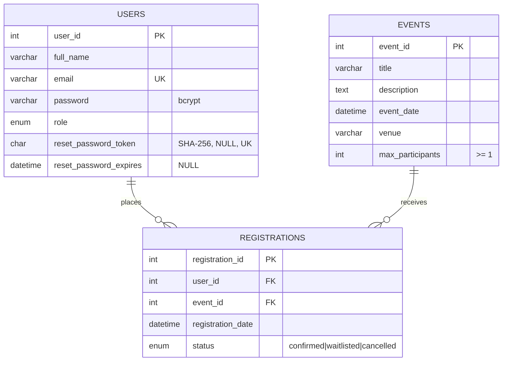
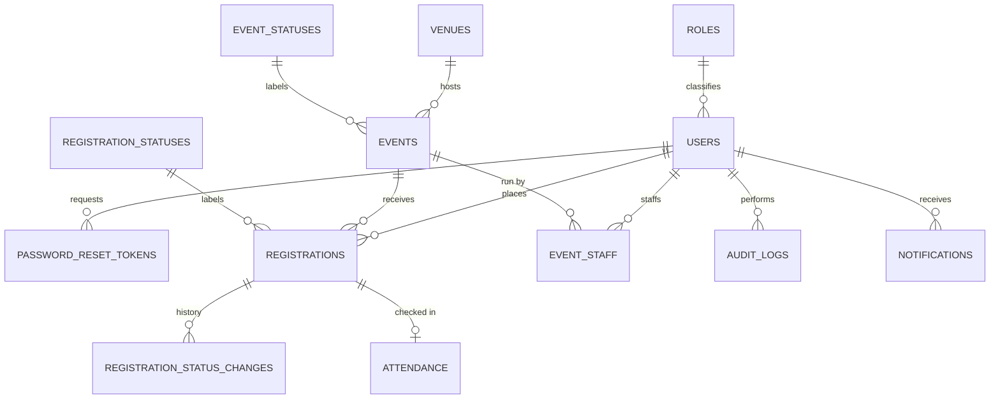

# Database & Code Audit — Event Registration System

**Scope:** `event-registration-system/` (Node.js 18 · Express 4 · Sequelize 6 · EJS · SQLite/MySQL/PostgreSQL)
**Branch:** `arena/fb51bb4e-event-registration-system`
**Method:** static read of every model / controller / route / view + live run of the app against a scratch database (`DB_STORAGE=/tmp/app.sqlite`) + `npm test`.
**Verdict in one line:** the *logical* design (USERS — REGISTRATIONS — EVENTS) is sound and already 1NF/2NF/3NF-compliant for what it models, but the ERD was **wrong** (diagram did not match the DDL and the relationship lines did not touch the actual foreign keys), the schema is **under-modelled** for the features the system advertises, and there were **11 real defects** — 4 of them security-relevant — in the code around the database.

---

## 1. Summary of findings

| # | Area | Severity | Finding | Status |
|---|------|----------|---------|--------|
| 1 | Security (session) | 🔴 Critical | `SESSION_SECRET` silently defaulted to a string that is published in the repo → anyone can forge a signed `connect.sid` cookie and log in as any admin. Not caught in production either. | **Fixed** — boot now refuses to start in production without `SESSION_SECRET`; cookie renamed/`secure`/`trust proxy` set. |
| 2 | Security (CSRF) | 🔴 Critical | No CSRF protection on any POST (register, cancel, event CRUD, role change, password reset). One visited link could delete every event. | **Fixed** — session-bound `_csrf` token, checked for every POST/PUT/PATCH/DELETE; `crypto.timingSafeEqual`. |
| 3 | Security (open redirect) | 🔴 Critical | `?next=` and `next` form field were passed straight to `res.redirect()` → `//evil.tld` phishing after a genuine login. | **Fixed** — `safeRedirect()` only allows local paths. |
| 4 | Security (session fixation) | 🟠 High | Session id was never regenerated on login/registration. | **Fixed** — `req.session.regenerate()` on login and sign-up. |
| 5 | Security (password reset) | 🟠 High | Reset token stored **in plaintext** and looked up by value; any DB read (backup, log, SQL injection, admin screen) is a full account takeover. | **Fixed** — only `SHA-256(token)` is stored; lookup hashes the URL token; token cleared after use and on password change. |
| 6 | Security (admin reset) | 🟠 High | `/admin/users/:id/reset-password` fell back to the literal password `password123` when the field was empty, then printed the new password in a flash message. | **Fixed** — password is required, validated, never echoed; the UI no longer hard-codes `password123`. |
| 7 | Security (brute force) | 🟠 High | No throttling on `/login`, `/forgot-password`, `/reset-password/:token`; bcrypt cost 10 makes the server a cheap oracle. | **Recommendation** (see §7.1) |
| 8 | Data integrity (race) | 🟠 High | Two simultaneous cancellations could each promote a different waitlisted person → **overbooking**, even though registration was transactional. | **Fixed** — promotion is now inside a transaction with a row lock and a fresh capacity re-count. |
| 9 | Data integrity (race) | 🟡 Medium | Admin status change and waitlist enrolment were not transactional; a registration could be flipped to `confirmed` past capacity. | **Fixed** — both wrapped in transactions with capacity re-checks. |
| 10 | Business logic | 🟡 Medium | `POST /events/:id/waitlist` accepted waitlist entries for events with **free seats** (a visitor could park on the waitlist and never take a seat). | **Fixed** — 409 "seats still available" instead. |
| 11 | Business logic | 🟡 Medium | Waitlist auto-promotion could confirm people for events that **already happened**. | **Fixed** — promotion skips concluded events. |
| 12 | Operations | 🟡 Medium | `npm test` ran `sequelize.sync({ force: true })` against the **default database file** — the test suite silently wiped the demo/defence database. | **Fixed** — suite runs on `:memory:` (override with `TEST_DB_STORAGE`). |
| 13 | Data integrity | 🟡 Medium | No length validation anywhere; a 200-char name blew up as SQLite/MySQL error → HTTP 500 instead of a 422. | **Fixed** — limits mirror the column sizes; bcrypt 72-byte cap enforced. |
| 14 | Correctness | 🟡 Medium | Admins could create an event **in the past**, which was then instantly unregisterable. | **Fixed** — "must be in the future" on create. |
| 15 | Correctness (timezone) | 🟡 Medium | `datetime-local` values were parsed in the *server's* timezone and re-rendered in the server's timezone, while the UI displays Asia/Manila. Event times shifted by 8 h whenever the server was not on PHT. | **Fixed** — parse `+08:00`, format with `Intl` / `Asia/Manila`. |
| 16 | Security (export) | 🟡 Medium | Attendance CSV wrote participant names raw → formula injection (`=HYPERLINK(...)`) executes in Excel. | **Fixed** — leading `= + - @` prefixed with `'`. |
| 17 | Security (privacy) | 🟡 Medium | `/admin/users` loaded **every column including `password` hashes and reset tokens** into the view model. | **Fixed** — attributes excluded. |
| 18 | Security (redirect) | 🟢 Low | `adminController.updateStatus` redirected to the raw `Referer` header. | **Fixed** — fixed server-side target. |
| 19 | Correctness | 🟢 Low | Search input was interpolated into `LIKE` without escaping `%`/`_`. | **Fixed** — `escapeLike()`. |
| 20 | Correctness | 🟢 Low | Attendance/CSV lists included concluded events; `status` query param accepted arbitrary values. | **Fixed** — whitelist for the param; see §7.4 for past-event policy. |
| 21 | Performance | 🟢 Low | Only 1 index existed; every capacity count was a full scan of `REGISTRATIONS` (`idx_reg_event_status`, `idx_reg_user` were in `schema.sql` but **never created by Sequelize**). | **Fixed** — indexes declared on the models (created by `sync()`), plus `EVENTS(event_date)`, `USERS(role)`, `USERS(reset_password_token)` unique. |
| 22 | Consistency | 🟢 Low | `define: { underscored, freezeTableName, timestamps }` was only applied to MySQL/PostgreSQL, not SQLite — the demo dialect silently behaved differently. | **Fixed** — shared options for every dialect. |
| 23 | Normalisation | 🟠 Design | Reset-token columns in `USERS`; free-text `venue`; `ENUM` statuses; attendance & status history not modelled; **no audit/attendance/venue/category/notification tables at all**. | **Documented** — §4, §5 and `docs/schema-3nf.sql`. |
| 24 | Documentation | 🟠 Doc | ERD did not match the DDL: no reset-token columns, connectors not anchored to `user_id`/`event_id`, wrong cardinality strip direction, `docs/ERD.png` stale vs `ERD.svg`; `GROUP BY e.event_id` sample query fails on MySQL 8. | **Fixed** — regenerated ERD/PNG, corrected `schema.sql`. |

Everything marked **Fixed** has been changed in this branch and re-verified end-to-end (§9).

---

## 2. Current schema — what it actually is

```sql
USERS(user_id PK, full_name, email UQ, password, role, reset_password_token, reset_password_expires)
EVENTS(event_id PK, title, description, event_date, venue, max_participants)
REGISTRATIONS(registration_id PK, user_id FK→USERS, event_id FK→EVENTS,
              registration_date, status, UNIQUE(event_id, user_id))
```



*(Regenerate `docs/ERD.svg` / `docs/ERD.png` with `python3 docs/generate-diagrams.py` — the committed diagram now shows exactly this.)*

---

## 3. Is it 3NF? Table-by-table proof

3NF requires: **1NF** (atomic values, no repeating groups) → **2NF** (no partial dependency on part of a composite key) → **3NF** (no transitive dependency of a non-key attribute on another non-key attribute).

### 3.1 USERS
* Candidate key: `user_id`; alternate key: `email` (UNIQUE). Every other attribute depends on the *whole* key and only on the key.
* `role` is an ENUM, not a stored label that could contradict another column → no transitive dependency.
* **1NF:** atomic. **2NF:** single-attribute PK, so partial dependency is impossible. **3NF:** clean *except* the reset-token pair (see below).

### 3.2 EVENTS
* Candidate key: `event_id`; all attributes describe the event itself.
* **⚠ transitive dependency:** `venue` is free text. The moment a venue has an address, capacity, contact person or map link, `event_id → venue → {address, capacity, contact}` breaks 3NF — that data is about the *venue*, not the event.
* `max_participants` is an attribute of the event (legitimate). It is **not** derived data, so it is not a violation — but the *computed* counter "taken" must never be stored (`decorateWithCapacity()` correctly computes it with `COUNT`).

### 3.3 REGISTRATIONS
* Candidate key: `registration_id`; alternate key `(event_id, user_id)`.
* With the composite key `(event_id, user_id)` every remaining attribute (`registration_date`, `status`) depends on **both** parts → **2NF OK**.
* No non-key attribute determines another → **3NF OK**.
* Deliberate, documented redundancy: `status = 'cancelled'` rows stay in the table instead of moving to an archive; this is *not* a normal-form violation, it is a history requirement. What *is* missing is **when/why/by whom** the status changed (see §4.4).

### 3.4 Verdict

| Table | 1NF | 2NF | 3NF | Blocker |
|-------|-----|-----|-----|---------|
| USERS | ✅ | ✅ | ⚠️ | single-use reset token lives in the user row |
| EVENTS | ✅ | ✅ | ⚠️ | `venue` free text (transitive dependency waiting to happen) |
| REGISTRATIONS | ✅ | ✅ | ✅ | — (but no status history, no attendance) |

So: **the three tables are 3NF *for the attributes they contain***. The system is **not "3NF-complete" as a system**, because it is missing entities for facts it already produces (attendance, waitlist history, audit trail, venue, categories). That is the gap that should be closed before a defence panel asks "where do you record who actually showed up?"

### 3.5 Why the reset token in USERS is the interesting case

`reset_password_token` + `reset_password_expires` describe *one specific reset request*, not the user:

* they are **optional** and **short-lived** (1 hour) — the user row is perpetual;
* a token has its own identity (it is looked up by value, `UNIQUE(reset_password_token)`);
* a user accumulates *many* tokens over time (forgot password twice), and the current design only keeps the last one — earlier requests are silently destroyed;
* deleting an old token means `UPDATE USERS SET … = NULL`, i.e. mutating the user to clean up a different entity.

That is the textbook signal for **a separate `PASSWORD_RESET_TOKENS` entity** (proposed in §5.1). Removing those two columns makes `USERS` strictly 3NF/BCNF.

---

## 4. Missing tables (ranked by how much they hurt)

The application already performs these workflows; the database just has nowhere to put the facts.

### 4.1 `ATTENDANCE` — 🔴 highest priority
The system prints an "Official Attendance List", exports CSV, and has a "Signature" column — but there is **no attendance data**. Right now "attendance" = "has a confirmed registration", which is a different question (no-shows are invisible). This is the first question any panel asks.
```
ATTENDANCE(attendance_id PK, registration_id FK UNIQUE→REGISTRATIONS,
           checked_in_at, checked_in_by FK→USERS, remarks)
```

### 4.2 `PASSWORD_RESET_TOKENS`
See §3.5. Enables multiple/previous tokens, `used_at`, and clean invalidation.

### 4.3 `REGISTRATION_STATUS_CHANGES` (status history)
The system can answer "confirmed?" but not "when was it cancelled, promoted, or by whom?". Auto-promotion silently overwrites `status`, so the audit trail of the waitlist is lost. One row per transition (`from_status`, `to_status`, `changed_at`, `changed_by`, `reason`) — do **not** add `cancelled_at`/`confirmed_at` columns to `REGISTRATIONS`; with a status machine those columns become half-empty and repeat per transition.

### 4.4 `VENUES`
`EVENTS.venue VARCHAR(180)` is repeated text: "SMX Convention Center, Pasay City" is typed per event, so typos create different venues, and there is nowhere to store address/capacity/contact. Normalise to `VENUES(venue_id, name, address, city)` and keep `EVENTS.venue_id`.

### 4.5 `REGISTRATION_STATUSES` / `EVENT_STATUSES` / `ROLES` (lookup tables)
`ENUM`s are:
* **SQLite-hostile** — Sequelize creates `TEXT` with no `CHECK`, so the "enum" is enforced only by the ORM. `INSERT ... status='banana'` via any other client succeeds (verify: `PRAGMA table_info('REGISTRATIONS')`).
* impossible to extend without `ALTER TABLE` (add "checked-in" or "no-show" and you must migrate production).
* carry their own label, so a display label cannot be translated/edited without a deploy.
Lookup tables make these values data instead of schema.

### 4.6 `AUDIT_LOGS`
Admin actions (role changes, password resets, event deletion with all its registrations) currently leave **no trace**. A `log_id, actor_id, action, entity, entity_id, detail JSON, created_at` table is standard for any system with an admin role.

### 4.7 `EVENT_STAFF` (co-organisers)
`EVENTS` has no owner. Any admin can edit/delete anyone's event and nothing records who created it. Either add `created_by FK→USERS` (minimum) or the full `EVENT_STAFF(event_id, user_id, staff_role)` for co-organisers and check-in staff.

### 4.8 `NOTIFICATIONS` (outbox)
Confirmation e-mails and "you've been promoted off the waitlist" messages are the point of a waitlist, but they are only flashed in the HTTP response — a promoted participant is never told. An outbox table makes delivery retryable and testable without SMTP.

### 4.9 `EVENT_CATEGORIES`
Optional, but a real event system groups events by type (seminar/workshop/convention). Category must be its own table, not a repeated string, for the same reason as venue.

### 4.10 Sessions (if you move off the memory store)
`express-session`'s default store is process memory: every restart logs everybody out and it does not work with more than one process. A `SESSIONS(sid PK, expires, data)` table (or Redis) is the fix. See §7.1.

---

## 5. Proposed target schema

The full DDL is in **`docs/schema-3nf.sql`** (ready to run on MySQL 8). Highlights:



| Table | Purpose | Fixes |
|-------|---------|-------|
| `PASSWORD_RESET_TOKENS` | one row per reset request, SHA-256 hash + `used_at` | §3.5, §4.2 |
| `VENUES` | venue master data | §3.2, §4.4 |
| `REGISTRATION_STATUSES`, `EVENT_STATUSES`, `ROLES` | lookup tables | §4.5 |
| `REGISTRATION_STATUS_CHANGES` | immutable status audit | §4.3 |
| `ATTENDANCE` | 1:1 physical check-in | §4.1 |
| `AUDIT_LOGS` | admin traceability | §4.6 |
| `EVENT_STAFF` + `EVENTS.created_by` | ownership | §4.7 |
| `NOTIFICATIONS` | delivery outbox | §4.8 |

**Cardinalities to draw on the ERD** (they are what the current diagram got wrong):

* `USERS (1) ──── (0..*) REGISTRATIONS` — FK `REGISTRATIONS.user_id`, `NOT NULL`.
* `EVENTS (1) ──── (0..*) REGISTRATIONS` — FK `REGISTRATIONS.event_id`, `NOT NULL`.
* `USERS (1) ──── (0..*) PASSWORD_RESET_TOKENS`; `REGISTRATIONS (1) ──── (0..1) ATTENDANCE`.
* `VENUES (1) ──── (0..*) EVENTS` — FK `EVENTS.venue_id`, nullable.

### Migration path (safe, no data loss)

1. Create the new tables (all additive) and backfill:
   `INSERT INTO VENUES(name) SELECT DISTINCT venue FROM EVENTS;` → `UPDATE EVENTS e JOIN VENUES v ON v.name = e.venue SET e.venue_id = v.venue_id;`
2. Create `PASSWORD_RESET_TOKENS`, copy any live `USERS.reset_password_token` (hash already SHA-256 in this branch), then drop the two columns from `USERS`.
3. Create `REGISTRATION_STATUSES`, insert the three rows, add `status_code`, backfill from `status`, keep `status` as a generated/compat column for one release, then drop it.
4. Add `ATTENDANCE` and generate the check-in screen from it.
5. Replace `sequelize.sync()` with real migrations (`sequelize-cli` or Umzug) before touching production — `sync()` cannot drop/rename columns and will silently drift.
6. Re-run `npm test` after every step (it now runs on `:memory:`).

---

## 6. ERD problems found (and fixed)

| Problem | Detail | Fix |
|---------|--------|-----|
| Connectors not anchored to keys | Lines were drawn at `Y + HEAD + ROW*1.5` / `*2.5`, i.e. arbitrary y-values; the USERS line crossed `full_name`, the REGISTRATIONS↔EVENTS line crossed `registration_date`, and the crow's foot floated in empty space. | Each endpoint is computed from the row it represents (`user_id`, `event_id`), with a polyline when the rows are not aligned. |
| Diagram ≠ DDL | `reset_password_token` / `reset_password_expires` existed in the database but not in the diagram; indexes and business rules were only in a footnote. | Columns, key types (PK/FK/UQ), nullability and the constraint list are now on the diagram. |
| Cardinality strip direction reversed | Boxes are `USERS — REGISTRATIONS — EVENTS` but the strip read `[EVENTS] 1 — 0..* [REGISTRATIONS] 0..* — 1 [USERS]`, i.e. mirrored. | Strip now follows the boxes; both relationships read left→right. |
| Misleading labels | "one user places many registrations" was printed across the `full_name` field and the foot was drawn without a bar (reading as optional). | Removed the floating labels; the mandatory-one bar (`1`) and crow's foot (`0..*`) are the notation. |
| Stale PNG | `docs/ERD.png` was an older export than `docs/ERD.svg` (the PNG did not even contain the same footer text); docs embed the PNG in PDFs. | Both regenerated from the same script (`python3 docs/generate-diagrams.py`) — see the new `docs/ERD.png`. |
| Unused CSS class | `.fk` was never applied (the "FK" badges were drawn with the `.pk` class), so foreign keys rendered in the PK colour. | Key badges now use `pk` / `fk` / `uq` correctly. |
| Wrong sample SQL | `SELECT e.* … GROUP BY e.event_id` fails under MySQL 8's default `ONLY_FULL_GROUP_BY`. | Rewritten as correlated subqueries in `docs/schema.sql`. |
| Enum label drift | ERD said `ENUM(admin|participant)`; SQLite stores `TEXT`, so the drawing promised enforcement the demo DB does not have. | Documented in the diagram footer and §4.5. |

---

## 7. Remaining recommendations (not implemented — need a decision)

### 7.1 Deployment hardening
* **Rate limiting / lockout** on `/login`, `/forgot-password`, `/reset-password/:token` (`express-rate-limit` + per-account counters). Currently unlimited guesses.
* **Persistent session store** (Redis, or the `session` table) — the memory store drops every session on restart and cannot scale past one process.
* **HTTPS-only cookies** — done (`secure` when `NODE_ENV=production`), but requires TLS termination in front of the app.
* **CSP / HSTS** headers — only `nosniff`, `X-Frame-Options`, `Referrer-Policy` are set now.
* `package.json` has no `.env.example` in the repo even though the README tells you to copy it — it has been added, together with a `.gitignore` (see §9).

### 7.2 Schema-level
* **Capacity is a race between app and DB.** The `UNIQUE(event_id, user_id)` index is enforced by the database, but `COUNT(*) < max_participants` is only enforced in application code inside a transaction. A trigger, or a `confirmed_count` column guarded by a `CHECK`, would make overbooking impossible even for direct SQL clients. (Trade-off: triggers are dialect-specific.)
* `ON UPDATE CASCADE` on surrogate integer keys is pointless — the keys never change. Harmless, but a panel may ask; `ON DELETE CASCADE` is the part that matters.
* `REGISTRATIONS.registration_date` is overwritten when a cancelled registration is reactivated (`store()`), so the original registration date is lost. With `REGISTRATION_STATUS_CHANGES` you keep both.
* Consider `EVENTS.end_date` / duration, `EVENTS.registration_deadline`, `EVENTS.slug`, `EVENTS.image_url` if the UI grows; all are event attributes (still 3NF).
* Consider soft delete (`deleted_at`) for events: `destroy()` currently hard-deletes the event **and all its registrations** in one click, which destroys attendance history.

### 7.3 Application
* Pagination on `/`, `/admin/events`, `/admin/users`, `/admin/events/:id/participants` (all currently `findAll()` everything).
* Transactions around event deletion and admin password/role changes for symmetric audit logging.
* `sequelize.sync()` at boot is fine for a demo; move to migrations before real data exists.
* The email-less account creation path (registering someone creates a `User` with a random password) means anyone who knows a participant's e-mail can "register" them; combine with `NOTIFICATIONS` + e-mail verification.

### 7.4 Past events — policy decision
Attendance/CSV export is allowed for concluded events (that is when you need it) but the *status dropdown* still lets an admin confirm/waitlist people for a past event. Decide: (a) lock status changes after the event date, or (b) allow corrections and log them in `REGISTRATION_STATUS_CHANGES`. Option (b) is what §5 supports.

---

## 8. What changed in this branch

| File | Change |
|------|--------|
| `middlewares/auth.js` | refreshed user per request, `safeRedirect`, `csrfProtection`, `regenerateSession` |
| `middlewares/validate.js` | length limits, bcrypt 72-byte cap, future-date option, exported `LIMITS` |
| `config/database.js` | shared `define` options for all dialects, configurable timezone |
| `server.js` | production secret guard, security headers, `trust proxy`, secure/rolling cookie, CSRF middleware, Asia/Manila `formatDateTimeLocal` |
| `models/User.js` | `CHAR(64)` hashed token, `hashResetToken()`, unique token index, role index |
| `models/Event.js` | `event_date` index, removed unused `upcoming` scope |
| `models/Registration.js` | `(event_id,status)`, `(user_id,status)`, `(status,registration_date)` indexes |
| `controllers/registrationController.js` | transactional waitlist, capacity re-check, no waitlist on open events, `promoteFromWaitlist()` with lock + capacity guard, past-event guard, session-safe redirects |
| `controllers/adminController.js` | transactional status change, CSV injection escaping, no `Referer` redirect, hashes excluded from `/admin/users`, mandatory admin password reset, status whitelist |
| `controllers/eventController.js` | Asia/Manila parse + format, future-date validation, LIKE escaping, `idx`-friendly search |
| `controllers/authController.js` | session regeneration, `safeRedirect`, hashed token lookups, token revoke on password change, production-safe logging |
| `views/**` (14 files) | `_csrf` hidden field in every state-changing form; admin reset-password field |
| `test/system.test.js` | runs on `:memory:`, token-hash assertions |
| `docs/generate-diagrams.py`, `docs/ERD.svg`, `docs/ERD.png` | corrected ERD |
| `docs/schema.sql` | matches the models (indexes, `CHAR(64)` token, checks, MySQL 8-safe sample queries) |
| `docs/schema-3nf.sql` | **new** — proposed normalised v2 schema |
| `docs/DATABASE-AUDIT.md` | **new** — this report |
| `.env.example`, `.gitignore` | **new** — README referenced a file that did not exist |

---

## 9. Verification performed

```bash
npm test                       # 16/16 pass, now on :memory:
DB_STORAGE=/tmp/app.sqlite npm run seed
DB_STORAGE=/tmp/app.sqlite PORT=3000 node server.js
```

| Check | Result |
|-------|--------|
| `GET /`, `GET /events/1`, `GET /events/5` | 200 |
| `POST /events/1/register` **without** `_csrf` | 403 "form session expired" |
| `POST /events/1/register` with token | 201 confirmation |
| same e-mail again | 409 duplicate |
| `POST /events/1/waitlist` on a non-full event | 409 "seats are still available" |
| `POST /events/5/waitlist` on the full event | 201 waitlisted |
| admin cancels a confirmed seat on event 5 | waitlisted row auto-promoted, `COUNT(confirmed)` stays 5/5 |
| admin tries to confirm a cancelled row while 5/5 | refused with capacity message |
| `POST /login` with `next=//evil.example.com` | redirects to `/admin` (blocked) |
| forgot password → reset link | token in URL, **SHA-256 digest** in `USERS`, reset succeeds, token cleared |
| `/admin/users` HTML | contains no `$2a$` bcrypt hash |
| create event with a past date | 422 "must be in the future" |
| create event `2027-03-05T09:30` | stored `2027-03-05 01:30 UTC` (= 09:30 PHT) |
| indexes on a fresh database | 8 (unique + performance) created by `sync()` |

```sql
sqlite> PRAGMA index_list('REGISTRATIONS');
uq_registration_event_user | uq_reg_event_status | idx_reg_user_status | idx_reg_status_date
sqlite> PRAGMA index_list('USERS');
sqlite_autoindex_USERS_1 | uq_users_reset_token | idx_users_role
```
