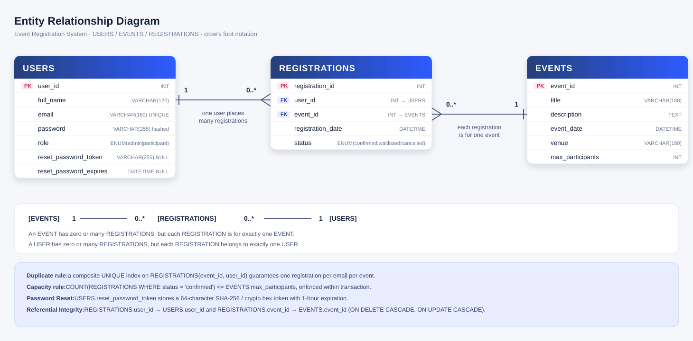
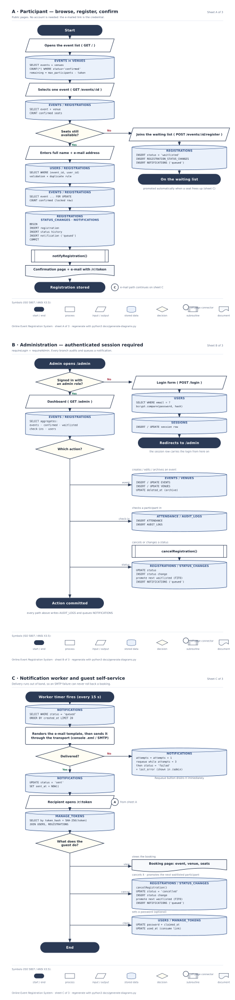
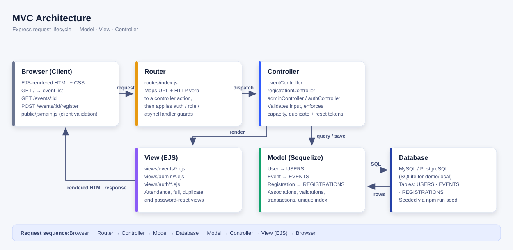

# Event Registration System — System Documentation

**Project:** Online Event Registration System  
**Pattern:** MVC (Model – View – Controller)  
**Stack:** Node.js 18+ · Express.js · Sequelize · MySQL / PostgreSQL / SQLite · EJS / HTML / CSS / JavaScript  

---

## Table of Contents

1. [System Requirements](#1-system-requirements)
2. [Entity Relationship Diagram (ERD)](#2-entity-relationship-diagram-erd)
3. [Data Dictionary](#3-data-dictionary)
4. [System Flowchart](#4-system-flowchart)
5. [Feature Specification](#5-feature-specification)
6. [MVC Architecture & File Mapping](#6-mvc-architecture--file-mapping)
7. [Route / Endpoint Reference](#7-route--endpoint-reference)
8. [Business Rules](#8-business-rules)
9. [Automated Test Suite & Verification](#9-automated-test-suite--verification)
10. [Academic Defense Guide & Presentation Checklist](#10-academic-defense-guide--presentation-checklist)

---

## 1. System Requirements

| Category | Requirement | Notes |
|----------|-------------|-------|
| Runtime | **Node.js 18+** | Verified on Node 20 LTS |
| Web framework | **Express.js ^4.19** | Routing + middleware pipeline |
| ORM | **Sequelize ^6.37** | Models, associations, validations, transactions |
| Database | **MySQL 8** or **PostgreSQL 14+** | SQLite 3 supported for zero-setup demo |
| DB driver | **mysql2** or **pg + pg-hstore** or **sqlite3** | Dialect drivers |
| Templating | **EJS ^3.1** | Server-side rendered HTML |
| Front end | HTML5, CSS3, Vanilla JavaScript | Responsive UI + print stylesheet |
| Security | `bcryptjs`, Node `crypto` | Adaptive password hashing + 64-char hex reset tokens |

---

## 2. Entity Relationship Diagram (ERD)



*Vector source: `docs/ERD.svg` · raster copy: `docs/ERD.png`*

**Relationship notation (crow's foot)**

```
[VENUES] 1 ──── 0..* [EVENTS] 1 ──── 0..* [REGISTRATIONS] 0..* ──── 1 [USERS]
                                              │
                        ┌─────────────────────┴─────────────────────┐
             0..1 [ATTENDANCE]                        0..* [REGISTRATION_STATUS_CHANGES]
```

| Relationship | Cardinality | Meaning |
|--------------|-------------|---------|
| VENUES → EVENTS | one-to-many (1 : 0..*) | A venue hosts zero or many events; each event has exactly one venue (`EVENTS.venue_id` NOT NULL). The venue name/address is stored once. |
| EVENTS → REGISTRATIONS | one-to-many (1 : 0..*) | An event may have zero or many registrations; each registration is for exactly one event. |
| USERS → REGISTRATIONS | one-to-many (1 : 0..*) | A user may have zero or many registrations; each registration belongs to exactly one user. |
| REGISTRATIONS | associative entity | Resolves the many-to-many participant/event relationship; tracks registration status ('confirmed' \| 'waitlisted' \| 'cancelled'). |
| REGISTRATIONS → ATTENDANCE | one-to-optional-one (1 : 0..1) | A registration may be checked in once; `UNIQUE(registration_id)` makes a second check-in impossible. |
| REGISTRATIONS → REGISTRATION_STATUS_CHANGES | one-to-many (1 : 0..*) | Immutable history of every status transition (`changed_by` NULL = automated promotion). |
| USERS → AUDIT_LOGS | one-to-many (1 : 0..*) | Every administrative action, with a nullable actor so history survives a deleted user. |
| SESSIONS | standalone | Session store for `express-session`; no foreign key. |

> All relationship lines in the diagram are anchored to the actual key rows
> (`REGISTRATIONS.user_id`, `REGISTRATIONS.event_id`, `EVENTS.venue_id`, …).
> For the normal-form analysis, the list of design defects that were fixed and
> the stricter proposed variant, see **[DATABASE-AUDIT.md](./DATABASE-AUDIT.md)**
> and **[schema-3nf.sql](./schema-3nf.sql)**.

---

## 3. Data Dictionary

### 3.1 USERS — user accounts (administrators and participants)

| Field | Type | Key | Constraints | Description |
|-------|------|-----|-------------|-------------|
| `user_id` | INT AI | **PK** | auto increment | Surrogate primary key |
| `full_name` | VARCHAR(120) | | NOT NULL | Complete name of the user |
| `email` | VARCHAR(160) | UQ | NOT NULL, valid email, unique | Login identifier; duplicate-registration anchor |
| `password` | VARCHAR(255) | | NOT NULL | Bcrypt hash (10 salt rounds) |
| `role` | ENUM | | NOT NULL, default `participant` | `admin` (management) or `participant` |
| `reset_password_token` | CHAR(64) | UQ | NULL allowed | **SHA-256 digest** of the 64-hex token sent to the user; the raw token is never stored. Unique index; cleared after use or on password change |
| `reset_password_expires`| DATETIME | | NULL allowed | Expiration timestamp (1 hour TTL) |

*Indexes: `UNIQUE(email)`, `UNIQUE(reset_password_token)`, `(role)`.*

### 3.2 EVENTS — events created by the organiser

| Field | Type | Key | Constraints | Description |
|-------|------|-----|-------------|-------------|
| `event_id` | INT AI | **PK** | auto increment | Surrogate primary key |
| `title` | VARCHAR(180) | | NOT NULL | Event name shown on the listing page |
| `description` | TEXT | | NULL allowed | Full details of the event |
| `event_date` | DATETIME | | NOT NULL | Date and time of the event |
| `venue` | VARCHAR(180) | | NOT NULL | Where the event is held |
| `max_participants` | INT | | NOT NULL, ≥ 1 | Slot limit — registration blocked once reached |
| `venue_id` | INT | **FK** | → `VENUES.venue_id`, NOT NULL | Where the event is held (normalised) |
| `deleted_at` | DATETIME | | NULL allowed | Soft delete: archived events keep their registrations and attendance |

*Indexes: `(event_date)` — every listing is ordered by date; `(venue_id)`.*

### 3.3 REGISTRATIONS — the booking record (associative entity)

| Field | Type | Key | Constraints | Description |
|-------|------|-----|-------------|-------------|
| `registration_id` | INT AI | **PK** | auto increment | Surrogate primary key |
| `user_id` | INT | **FK** | → `USERS.user_id`, NOT NULL, CASCADE | Who registered |
| `event_id` | INT | **FK** | → `EVENTS.event_id`, NOT NULL, CASCADE | Which event |
| `registration_date` | DATETIME | | NOT NULL, default now | When the registration was placed |
| `status` | ENUM | | NOT NULL, default `confirmed` | `confirmed` \| `waitlisted` \| `cancelled` |
| *(composite index)* | | UQ | `UNIQUE(event_id, user_id)` | Database-level duplicate prevention |

*Indexes: `UNIQUE(event_id, user_id)`, `(event_id, status)`, `(user_id, status)`,
`(status, registration_date)` — the last one backs FIFO waitlist promotion.*

### 3.4 VENUES — venue master data

| Field | Type | Key | Constraints | Description |
|-------|------|-----|-------------|-------------|
| `venue_id` | INT AI | **PK** | auto increment | Surrogate primary key |
| `name` | VARCHAR(180) | UQ | NOT NULL, unique together with `city` | Venue name |
| `address` | VARCHAR(255) | | NULL allowed | Street address |
| `city` | VARCHAR(120) | UQ | NOT NULL, default `''` | City; empty string keeps the composite unique key enforceable |

### 3.5 ATTENDANCE — physical check-in (1:0..1 with REGISTRATIONS)

| Field | Type | Key | Constraints | Description |
|-------|------|-----|-------------|-------------|
| `attendance_id` | INT AI | **PK** | auto increment | Surrogate primary key |
| `registration_id` | INT | **FK/UQ** | → `REGISTRATIONS`, NOT NULL, **UNIQUE**, CASCADE | The registration that was checked in |
| `checked_in_at` | DATETIME | | NOT NULL, default now | When the participant arrived |
| `checked_in_by` | INT | **FK** | → `USERS`, NULL allowed, SET NULL | Which admin/staff scanned them in |
| `remarks` | VARCHAR(255) | | NULL allowed | Free note |

### 3.6 REGISTRATION_STATUS_CHANGES — audit trail of the status machine

| Field | Type | Key | Constraints | Description |
|-------|------|-----|-------------|-------------|
| `change_id` | INT AI | **PK** | auto increment | Surrogate primary key |
| `registration_id` | INT | **FK** | → `REGISTRATIONS`, NOT NULL, CASCADE | Registration whose status changed |
| `from_status` | ENUM | | NULL allowed | Previous status (`NULL` for the first row) |
| `to_status` | ENUM | | NOT NULL | New status |
| `changed_at` | DATETIME | | NOT NULL | When the transition happened |
| `changed_by` | INT | **FK** | → `USERS`, NULL allowed | `NULL` = automated (waitlist promotion) |
| `reason` | VARCHAR(255) | | NULL allowed | Human-readable explanation |

### 3.7 AUDIT_LOGS — administrative action log

| Field | Type | Key | Constraints | Description |
|-------|------|-----|-------------|-------------|
| `log_id` | BIGINT AI | **PK** | auto increment | Surrogate primary key |
| `actor_id` | INT | **FK** | → `USERS`, NULL allowed, SET NULL | Who performed the action (`NULL` = anonymous/system) |
| `action` | VARCHAR(60) | | NOT NULL | e.g. `event.archive`, `user.role_change` |
| `entity` / `entity_id` | VARCHAR(60) | | NULL allowed | Resource kind and id |
| `detail` | JSON/TEXT | | NULL allowed | Before/after values |
| `created_at` | DATETIME | | NOT NULL | Timestamp (indexed) |

### 3.8 SESSIONS — session store

| Field | Type | Key | Constraints | Description |
|-------|------|-----|-------------|-------------|
| `sid` | VARCHAR(64) | **PK** | — | Signed session id |
| `data` | TEXT | | NOT NULL | Serialised session payload |
| `expires_at` | DATETIME | | NOT NULL, indexed | Expiry; purged by the store's cleanup timer |

### 3.9 EVENTS.deleted_at — soft delete marker

| Field | Type | Key | Constraints | Description |
|-------|------|-----|-------------|-------------|
| `deleted_at` | DATETIME | | NULL allowed, indexed via `EVENTS` | `NULL` = active; a timestamp = archived. Archived events are hidden from every listing while their registrations, attendance and status history stay intact. |

---

## 4. System Flowchart



```
Start
  ↓
User views event list                       ← eventController.publicList()   GET /
  ↓
Select event                                ← eventController.show()         GET /events/:id
  ↓
Event has available slots? ── No ──→ Show "Event full" (Waitlist)  →  End
  ↓ Yes
Enter participant details                   ← POST /events/:id/register
  ↓
Validate email and required fields          ← middlewares/validate.js
  ↓
Save registration (or reactivate cancelled) ← Registration.create() / update() inside transaction
  ↓
Increase registered participant count       ← COUNT(confirmed) recomputed atomically
  ↓
Show confirmation receipt & account notice  ← events/confirmation.ejs with reference number
  ↓
End
```

---

## 5. Feature Specification

### F1 — Event Creation, Editing & Deletion (Admin)
* **Create** (`POST /admin/events`) and **Edit** (`PUT /admin/events/:id`).
* Capacity cannot be reduced below current confirmed head-count.
* Timezone-safe date input preserves local time format without UTC shift.

### F2 — Public Event Listing & Search
* Real-time capacity meters and badges (`X slot(s) left`, `Event full`, `Concluded`).
* Search query filter (`?q=`) matches title, venue, or description.

### F3 — Online Registration & Duplicate Prevention
* Atomic registration inside database transaction with parent row locking.
* Duplicate prevention backed by unique composite index `(event_id, user_id)`.
* Clean re-registration: users who previously cancelled can re-register without collision.

### F4 — Waiting List & Auto-Promotion
* Full events permit waitlist enrollment (`status = 'waitlisted'`).
* Cancelling a confirmed registration automatically promotes the earliest waitlisted participant using FIFO ordering (`ORDER BY registration_date ASC, registration_id ASC`).

### F5 — Forgot Password & Password Reset Flow
* User submits email at `/forgot-password`.
* System generates 64-char crypto token with 1-hour expiration.
* User sets new password at `/reset-password/:token`, hashed via bcrypt.
* Interactive demo link displayed on UI for offline academic defense demonstration.

### F6 — Attendance Reporting (A4 Print & CSV Export)
* Clean printable A4 layout with signatures blocks and verification data.
* UTF-8 BOM CSV export compatible with Microsoft Excel.

### F7 — User Account Administration (Admin)
* `/admin/users` displays all system users, registration counts, and roles.
* Admin can promote/demote roles and perform administrative password resets.

---

## 6. MVC Architecture & File Mapping



| Layer | Files | Purpose |
|-------|-------|---------|
| **Model** | `models/User.js`, `Event.js`, `Registration.js`, `index.js` | Schema definitions, validation rules, associations, bcrypt hooks |
| **View** | `views/events/*.ejs`, `admin/*.ejs`, `auth/*.ejs`, `partials/*.ejs` | Server-rendered EJS templates, CSS styles, client scripts |
| **Controller**| `controllers/*.js` | Request processing, business constraints, state transitions |
| **Router** | `routes/index.js` | HTTP routing table, role authorization guards, async wrappers |

---

## 7. Route / Endpoint Reference

| Method | Path | Access | Handler | View / Action |
|--------|------|--------|---------|---------------|
| `GET` | `/` | Public | `eventController.publicList` | `events/index.ejs` |
| `GET` | `/events/:id` | Public | `eventController.show` | `events/show.ejs` |
| `POST` | `/events/:id/register` | Public | `registrationController.store` | `events/confirmation.ejs` |
| `POST` | `/events/:id/waitlist` | Public | `registrationController.waitlist` | `events/confirmation.ejs` |
| `POST` | `/registrations/:id/cancel` | Authenticated | `registrationController.cancel` | Redirect |
| `GET` | `/register` | Public | `authController.showRegister` | `auth/register.ejs` |
| `POST` | `/register` | Public | `authController.register` | Redirect |
| `GET` | `/login` | Public | `authController.showLogin` | `auth/login.ejs` |
| `POST` | `/login` | Public | `authController.login` | Redirect |
| `POST` | `/logout` | Authenticated | `authController.logout` | Redirect |
| `GET` | `/forgot-password` | Public | `authController.showForgotPassword`| `auth/forgot-password.ejs` |
| `POST` | `/forgot-password` | Public | `authController.forgotPassword` | `auth/forgot-password.ejs` |
| `GET` | `/reset-password/:token`| Public | `authController.showResetPassword`| `auth/reset-password.ejs` |
| `POST` | `/reset-password/:token`| Public | `authController.resetPassword` | Redirect |
| `GET` | `/change-password` | Authenticated | `authController.showChangePassword`| `auth/change-password.ejs` |
| `POST` | `/change-password` | Authenticated | `authController.changePassword` | Redirect |
| `GET` | `/my-registrations` | Authenticated | `authController.myRegistrations` | `my-registrations.ejs` |
| `GET` | `/admin` | Admin | `adminController.dashboard` | `admin/dashboard.ejs` |
| `GET` | `/admin/events` | Admin | `eventController.adminIndex` | `admin/events.ejs` |
| `GET` | `/admin/events/new` | Admin | `eventController.showCreateForm` | `admin/event-form.ejs` |
| `POST` | `/admin/events` | Admin | `eventController.create` | Redirect |
| `GET` | `/admin/events/:id/edit`| Admin | `eventController.showEditForm` | `admin/event-form.ejs` |
| `PUT` | `/admin/events/:id` | Admin | `eventController.update` | Redirect |
| `DELETE`| `/admin/events/:id` | Admin | `eventController.destroy` | Redirect |
| `GET` | `/admin/events/:id/participants` | Admin | `adminController.participants` | `admin/participants.ejs` |
| `GET` | `/admin/events/:id/attendance` | Admin | `adminController.attendance` | `admin/attendance.ejs` |
| `GET` | `/admin/events/:id/attendance.csv` | Admin | `adminController.attendanceCsv` | CSV Stream |
| `POST` | `/admin/registrations/:id/status` | Admin | `adminController.updateStatus` | Redirect |
| `GET` | `/admin/users` | Admin | `adminController.users` | `admin/users.ejs` |
| `POST` | `/admin/users/:id/role` | Admin | `adminController.updateUserRole` | Redirect |
| `POST` | `/admin/users/:id/reset-password` | Admin | `adminController.adminResetPassword`| Redirect |

---

## 8. Business Rules Summary

1. **Atomic Capacity Limit:** Enforced inside database transactions with parent row locks.
2. **Strict Duplicate Prohibition:** Guaranteed by unique constraint `(event_id, user_id)`.
3. **Re-Registration Reactivation:** Cleanly reactivates previously cancelled registrations.
4. **FIFO Waitlist Promotion:** Fills cancelled slots from the earliest waitlisted participant, inside the cancellation transaction, and only when a seat is actually free (no double promotion, no promotion for concluded events).
5. **Waitlist Only When Full:** The waiting list rejects submissions while seats are still available.
6. **Time-Limited Reset Tokens:** 64-char crypto tokens with 1-hour expiration; only the SHA-256 digest is stored.
7. **Past Event Guard:** Blocks registration/waitlist attempts on events that have already concluded; new events must be scheduled in the future.
8. **Capacity Floor Guard:** Admins cannot edit event capacity below current confirmed headcount, nor confirm a registration that would exceed capacity.
9. **CSRF Protection:** Every state-changing request must carry the session-bound `_csrf` token.
10. **Safe Redirects:** `?next=` targets are restricted to local paths.
11. **Attendance Integrity:** Only confirmed registrations can be checked in, and only once (`UNIQUE(registration_id)`).
12. **Full Traceability:** every status change, check-in, role change, password reset and event archive writes an `AUDIT_LOGS` row; registrations keep their whole status timeline.
13. **Soft Delete:** archiving an event never destroys registrations, attendance or history.
14. **Abuse Limits:** login is rate limited per IP and locked per account after 5 failures; password-reset and public registration endpoints have their own budgets; forgot-password responses do not reveal whether an address exists.

---

## 9. Automated Test Suite & Verification

The system includes 38 automated tests in `test/system.test.js` (they run against an in-memory database, so `npm test` never touches the demo data). The suite pins `DB_DIALECT=sqlite` itself, so a `.env` configured for MySQL cannot be wiped by a test run:

```bash
npm test
```

### Verified Test Categories:
1. **User Model & Authentication:** Bcrypt hashing, password validation, duplicate email rejection.
2. **Forgot Password:** Crypto token creation, 1-hour expiration timestamp, valid token lookup, successful reset, expired token rejection.
3. **Event Capacity:** Counter calculations, limit blocking on max capacity.
4. **Duplicate Prevention:** Unique index collision check, re-registration after cancellation.
5. **Waitlist & Promotion:** Waitlisting overflow registrations, FIFO auto-promotion.
6. **Input Validation:** Required field checks, regex formats, password lengths, future-date rule.
7. **Normalised schema:** venue FK is mandatory, venues are reused, check-in is unique, status history is append-only, audit rows are written, soft delete preserves registrations.
8. **Hardening:** rate limiter returns 429, account lockout engages/clears, sessions persist in the `SESSIONS` table.

---

## 10. Academic Defense Guide & Presentation Checklist

Refer to **`docs/DEFENSE-GUIDE.md`** for the complete defense script, question-and-answer prep, and rubric alignment.
